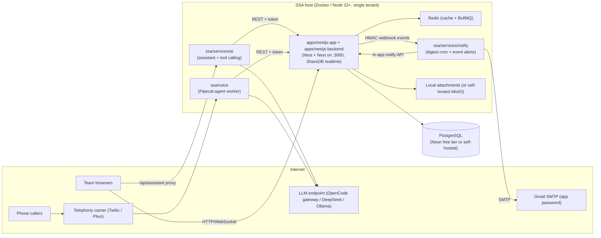

# Architecture — SSA single-tenant deployment

## Context



## Components

### 1. Teable core (unmodified upstream except the small `features/ssa` patch)

- `apps/nestjs-backend` — NestJS API + serves the built/served Next.js app; stores data in
  PostgreSQL (one schema per base); realtime via **ShareDB over SockJS** on `/socket`.
- `apps/nextjs-app` — Next.js Pages Router UI. Auth is session-cookie based; all API calls
  are same-origin `/api`.
- Redis is required in practice (BullMQ outbox + cache); it is self-hosted, not a cloud
  service.
- Notifications already exist upstream: a `notification` table, `GET /api/notifications`
  endpoints, a bell UI, and a realtime presence channel `__notification_user_<id>`.
  Our patch reuses `NotificationService.sendCommonNotify()` so companion services can
  raise bell notifications that appear instantly.

### 2. `features/ssa` (inside `apps/nestjs-backend`) — the only core patch

| Piece | Responsibility |
|---|---|
| `ssa.module.ts` | wires controller/services/listeners; V2 projections are discovered app-wide via `DiscoveryService` |
| `ssa-bootstrap.service.ts` | when `SSA_SINGLE_TENANT=true`: forces `disallowSignUp=true`, disables waitlist; idempotent on every boot |
| `ssa-event-forwarder.ts` | shared HMAC-signed webhook client: resolves `baseId` (cached), bounds body size (256 KB), 3 s timeout, suppresses duplicate emissions (operation-based, 10 s window) |
| `ssa-events.listener.ts` | **V1** bus listeners (`operation.records.create/update/delete`) + pure payload builders (`buildCreateEvent`, …) |
| `ssa-v2-projections.ts` | **V2** domain-event projections (`RecordCreated`, `RecordsBatchCreated`, `RecordUpdated`, `RecordsBatchUpdated`, `RecordsDeleted`) registered into the v2 container; skips undo/redo replays |
| `ssa.controller.ts` | `GET /api/ssa/health`, `POST /api/ssa/notify` (shared-secret header `X-SSA-Token`) → bell notification via `NotificationService.sendCommonNotify` (DB insert + realtime push) |

> **Write paths:** Teable routes writes through v1 or v2 depending on canary
> config — **new bases default to V2** (`x-teable-v2: true` response header).
> The legacy `table.record.*` bus events are NOT emitted on every REST write,
> which is why the forwarder listens to `operation.records.*` (V1) *and* the V2
> domain events. Both observe the same operation in some flows, hence the
> dedupe window. `record.updated` on the V1 path requires an app-UI window id
> header (`x-window-id`); v2 updates are always forwarded.

**Forwarded payload contract** (JSON body, HMAC-SHA256 in `X-SSA-Signature`,
event name in `X-SSA-EVENT`):

```jsonc
{
  "version": 1,
  "event": "record.created",   // record.created | record.updated | record.deleted
  "tableId": "tbl…", "baseId": "bse…",
  "recordIds": ["rec…"], "recordCount": 1, "isBulk": false, "truncated": false,
  "user": { "id": "usr…", "name": "…", "email": "…" },   // when known
  "timestamp": "…", "source": "user",                     // source: v2 only
  "records": [{ "id": "rec…", "fields": { "fld…": "…" } }],  // sampled, max 25
  "changes": { "fieldIds": ["fld…"], "cellContexts": [ … ] } // updates only, max 50
}
```

Design rules: listeners never block the request path; failures are logged, not
rethrown; the internal API is disabled when `SSA_INTERNAL_TOKEN` is unset;
forwarding is disabled when `SSA_EVENTS_WEBHOOK_URL` is unset and can be limited
to a table allow-list via `SSA_EVENTS_TABLES`.

### 3. `ssa/services/notify` (Node + Fastify)

- `POST /events` — HMAC-verified Teable events; a small rule engine maps record events to
  notifications (subscribe rules in `ssa/services/notify/notify.rules.json`), then:
  email via nodemailer (Gmail SMTP) and/or in-app via `POST /api/ssa/notify`.
- `cron` (node-cron) — daily digest: pull configured views/tables from the Teable REST
  API (personal access token), render an HTML summary (created today / due today /
  overdue / assigned to me), send one email per recipient to Gmail.
- `GET /healthz` — liveness + last digest run info.

### 4. `ssa/services/ai` (Node + Fastify)

- OpenAI-compatible chat client (`SSA_AI_BASE_URL`, `SSA_AI_API_KEY`, `SSA_AI_MODEL`,
  `SSA_AI_TEMPERATURE`). Works with the OpenCode gateway, DeepSeek, or a local Ollama
  (`http://host:11434/v1`).
- Tool calling against the Teable REST API with a scoped token: `list_tables`,
  `get_table_schema`, `query_records`, `create_record`, `update_record`, `summarize_table`.
- `POST /chat` streams SSE; the web app calls it through the Next.js route
  `/api/assistant/*` proxy so the API key never reaches the browser and sessions are
  same-origin.

### 5. `ssa/voice` (Python + Pipecat)

- Voice pipeline: carrier (Twilio Media Streams or Plivo) → STT → LLM (same configurable
  endpoint) → TTS, with tool calls that log outcomes into Teable (call log table:
  contact, direction, outcome, summary, recording URL).
- Modes: `local` (mic/speaker demo, no carrier costs) and `telephony`.
- The carrier is the one paid external dependency; the framework (Pipecat, BSD-2) and
  providers can be swapped per env.

## Security model (single tenant)

- **No public signup**: `SSA_SINGLE_TENANT=true` forces `disallowSignUp` + waitlist off;
  accounts are created via invitations only.
- **Service-to-service auth**: every companion→backend call carries
  `X-SSA-Token: <SSA_INTERNAL_TOKEN>`; every backend→notify event carries an
  `X-SSA-Signature` HMAC of the raw body (`SSA_EVENTS_WEBHOOK_SECRET`).
- **LLM key** stays in the `ssa/services/ai` process (server side only).
- **Teable API token** used by companion services is a scoped personal access token;
  rotate via the admin UI, store only in `.env`/deployment secrets.
- Companion services bind to localhost by default (`127.0.0.1`) and are reached through
  the reverse proxy or internal network only.

## Storage

- PostgreSQL is the single source of truth (Neon free tier is fine for a small team;
  any Postgres 15+ works). No other cloud storage is used: attachments live on local
  disk by default (`BACKEND_STORAGE_PROVIDER=local`) or on self-hosted MinIO.
- Redis runs alongside the app (docker-compose) and holds only cache/queue state.
